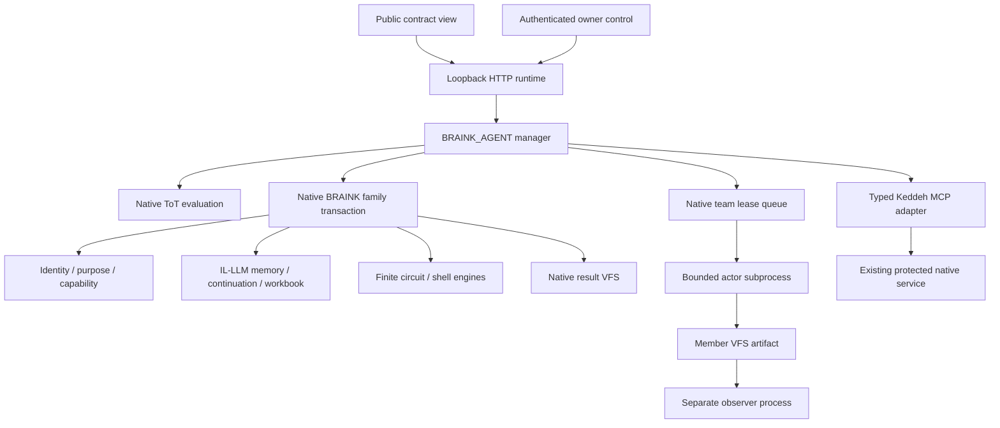

> KEDDEH SYSTEMS · RESEARCH & ENGINEERING
> Author: Codex-assisted engineering draft for Keddeh Systems · Contributions: native source integration, implementation and tests
> Publisher / rights holder: Keddeh Systems · Licence: reserved rights (upstream rights retained)
> Classification: public source documentation · Version: 0.1.0 · Status: engineering draft, no independent model assessment
> Revision date: 2026-10-11 · Evidence: SOURCE-PROVENANCE.json and evidence/

# Architecture

## Native lineage

The reviewed team/VFS implementation is pinned from public `Keddeh1/KEDDEH--` at `800cc656eab27bbd031048bb57d78150868137a2`. Its nested VFS provenance retains the upstream BRAINK-BETA-TEST commit. Native family, finite computation and ToT files are selected unchanged from that same public tree. The family resident dependency is pinned from public `aboudykeddeh276-stack/BRAINK-Sovereign-Virtual-Brain-Console` at `cfbee37c3c3a984201ce36f4c1d943ea395a63a3`. Exact selected bytes and paths are in the provenance manifest.

The newly authored `ExactCapabilityStore` corrects legacy substring routing without changing original native source. The original store is not served directly. Legacy HTTP handling, grant creation, mining and arbitrary product mutation are outside the manager's admitted interface.

## Durable stores

`family.sqlite3` owns native family state and hash-linked ledger. `teams/queue.sqlite` owns native team definitions, bounded jobs and lease transitions. Team and member VFS directories own immutable objects, versioned bindings and receipts. `memory/` retains manager birth, control, sector and undertaking records through native VFS. `manager.sqlite3` holds sector indexes and remote dispatch intent/readback.

Native family operations commit in one SQLite transaction. A birth spanning family/team/manager stores is a resumable composition, not distributed atomic commit: immutable keys allow reopening and completing remaining steps. An interrupted sector may leave its first family instantiated; repeat the identical source record to complete it. Changing that record requires a new sector revision ID.

The owner lock serializes manager family admission across processes. Native queue transactions retain lease exclusion and artifact fencing. Static path checks reject symlink redirection but do not isolate hostile same-UID code racing the filesystem.

## Local SDK and MCP

`braink_agent.mcp` is a bounded JSON-line stdio MCP facade. It supports initialize, ping, tools/list and tools/call and calls the same manager as the CLI and HTML controls. Only declared tools are callable. It inherits the invoking OS account authority and is not presented as a public MCP endpoint. MCP server availability does not establish a live cloud binding.

## Cloud boundary

Typed adapters implement MCP initialization, bounded JSON/SSE responses, no redirects, allowlisted tools, fixed admitted endpoint and transport timeouts. Existing credentials are supplied privately. Actor output and later command readback are stored separately. A transport timeout is uncertainty, not proof of failure. The manager never replays an existing dispatch ID automatically.

The live site is maintained by a separate deployment task. This repository does not deploy or change that site, widen grants, create paid resources or migrate accounts. The existing service's namespaces partition state under one owner credential; they do not create separate credential tenants.

## Operational adapters

`OperationalRuntime` extends the admitted native engine with explicit operational templates and a separate integrity observer for those templates. It inherits the native queue, claim, lease fencing, production, failure and VFS machinery. Legacy fixture adapters retain their original observer. Operational observer receipts prove bytes and immutable task binding; the separately scoped analyst process performs substantive source comparison, independent service observation or checkpoint recomputation. Neither is represented as different-model assessment.

`Workflows` persists immutable task intent before family birth, then reconciles each native stage from durable state. A per-task process lock prevents concurrent advancement. Native workers keep bounded leases and three attempts. After interruption, existing immutable output is read back before another external read is considered. No arbitrary caller URL or executable is accepted.

---
© 2026 Keddeh Systems. All rights reserved. Source custody, actor execution, durable readback and independent assessment are separate records.
